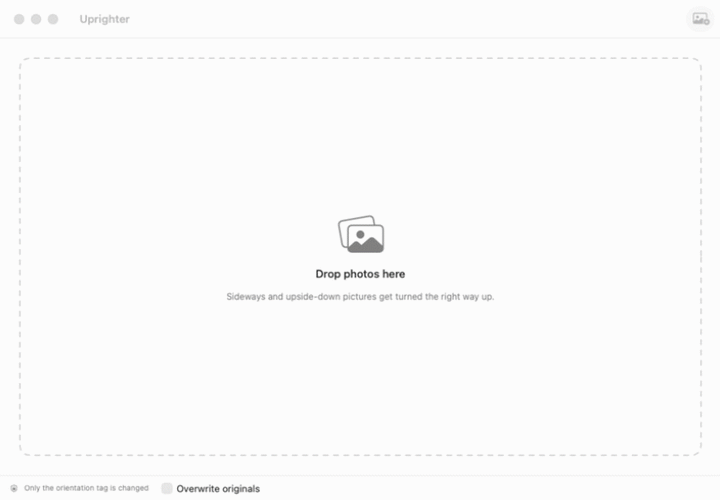

# Uprighter

Photos that came out sideways or upside down, turned the right way up — without
changing a single pixel.

> **Read this first.** Build it yourself with `make run` and it opens normally.
> If you download a prebuilt `.app` instead, macOS blocks it — go to **System
> Settings → Privacy & Security**, scroll to the bottom and click **Open Anyway**.
> And whichever way you install it: **keep a backup of your photos.**



Cameras record which way up a photo is in a small metadata tag. Strip that tag,
or let the wrong app rewrite it, and a perfectly good photo displays rotated.
Uprighter reads the picture itself to work out which way is up, then fixes it.

## What makes it safe

It only rewrites the orientation tag, so your image data is never re-encoded —
run it a hundred times and the pixels stay bit-for-bit what came out of the
camera.

That is enforced, not promised. Every write is fingerprinted against the
original *before* it may replace anything; if the image data differs by a single
bit, the write is discarded and your file is untouched. A photo that cannot be
corrected this way — PNG carries no orientation tag — is left alone with the
reason shown, never quietly re-encoded.

## Install

Needs the Xcode Command Line Tools (`xcode-select --install`). Full Xcode is not
required.

```bash
make run
```

`make install` puts the app in `~/Applications` and `uprighter` in `~/bin`.

## Use

**The app.** Drop in photos or a folder. Each one shows before and after, what
the decision was based on, and lets you override it by hand. "Overwrite
originals" writes back to the file it came from, including on an external drive.

**The command line.**

```bash
uprighter check ~/Pictures        # report only, change nothing
uprighter fix ~/Pictures -r       # write corrected copies
uprighter fix ~/Pictures -r -i    # correct the originals in place
```

Add `--min-margin 0.6` to skip anything it is not confident about.

## How it decides

Nine cues vote: the eye line from face landmarks, text baselines, body pose,
scene-classifier confidence, sky versus ground, edge structure, the existing
EXIF tag, and where the subject sits. All on your Mac via Apple's Vision
framework — nothing uploaded, no models to download.

96% correct across 168 rotations of 42 photographs, 99% on the ones it commits
to. [DESIGN.md](DESIGN.md) covers how that was measured and where it struggles.

MIT licensed. No warranty — see [LICENSE](LICENSE).
